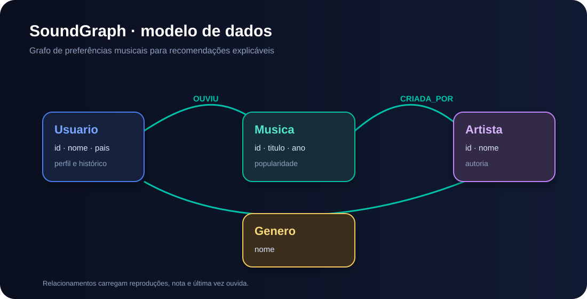

<div align="center">
  
  <h1>🎧 SoundGraph — Recomendação de músicas com Neo4j</h1>
  <p>Projeto prático da DIO para modelar preferências musicais e descobrir recomendações usando banco de dados em grafos.</p>
  <p>
    
    
    
    
    
    
  </p>
</div>

---

---

## Visão geral

O SoundGraph representa usuários, músicas, artistas, gêneros e interações em um grafo. A recomendação parte de um princípio simples e explicável: **usuários com gostos semelhantes ajudam a encontrar músicas que ainda não foram ouvidas**.

> Projeto autoral inspirado na organização dos exemplos públicos de [`neo4j-graph-examples`](https://github.com/neo4j-graph-examples/), sem reutilizar dados proprietários.

---

---

## 📄 Documentação Técnica Completa

Para uma análise aprofundada da arquitetura, formulação do algoritmo de recomendação, segurança, governança e conformidade com LGPD, consulte o dossiê técnico do projeto:

- 📥 [**Baixar Dossiê Técnico em PDF**](docs/Dossie_Tecnico_SoundGraph_Neo4j.pdf)

---
### 📍 Projeto em Destaque: Automação & Análise de Dados no McDonald's (Rua do Riachuelo, SP)

Atuação técnica focada na otimização de rotinas operacionais, monitoramento de métricas em tempo real e estruturação de rotinas de análise para o restaurante McDonald's localizado na Rua do Riachuelo, São Paulo. A solução integra pipelines de dados e visualização de dashboards funcionais para suporte à tomada de decisão rápida e controle de qualidade contínuo.

---

---

---

## Por que grafos?

Em um modelo relacional, a pergunta “o que pessoas parecidas escutaram e eu ainda não escutei?” exige várias junções. Em Neo4j, os caminhos entre `Usuario`, `Musica`, `Artista` e `Genero` são os próprios dados, tornando a consulta mais natural, legível e fácil de evoluir.

---

---

## Modelo do grafo



### Entidades e relacionamentos

- `(:Usuario {id, nome, pais})`
- `(:Musica {id, titulo, ano, popularidade})`
- `(:Artista {id, nome})`
- `(:Genero {nome})`
- `(:Usuario)-[:OUVIU {reproducoes, nota, ultimaVez}]->(:Musica)`
- `(:Musica)-[:CRIADA_POR]->(:Artista)`
- `(:Musica)-[:PERTENCE_A]->(:Genero)`

---

---

## Estrutura

```text
data/musicas.csv                       # Dataset pequeno e reproduzível
cypher/01-schema.cypher                 # Constraints e índices
cypher/02-carga.cypher                  # Importação idempotente com LOAD CSV
cypher/03-consultas.cypher              # Perguntas de negócio e recomendação
cypher/04-evidencias.cypher             # Consultas para gerar evidências no Browser
cypher/05-limpeza.cypher                # Limpeza controlada do dataset
docs/modelo-grafo.svg                  # Diagrama visual do modelo
docs/Dossie_Tecnico_SoundGraph_Neo4j.pdf # Dossiê técnico completo em PDF

---

## Governança 4.0 — Segurança e Qualidade

Este repositório adota controles de Governança 4.0 orientados à integridade documental, rastreabilidade e segurança da cadeia de suprimentos.

- **Quality Gate:** validação da estrutura do PDF, integridade documental, presença dos arquivos de dados e dos scripts Cypher.
- **Segurança de segredos:** varredura integral do histórico Git com Gitleaks Action v3.0.0.
- **Gestão de dados:** verificação automatizada da estrutura de dados e dos artefatos técnicos versionados.
- **Menor privilégio:** permissões mínimas e checkout sem persistência de credenciais.
- **Rastreabilidade:** evidências de execução e histórico de alterações disponíveis no GitHub Actions.

<div align="center">

[](https://github.com/Rafael-TOZATO/recomendacao-musicas-neo4j/actions/workflows/quality-gate.yml)
[](https://github.com/Rafael-TOZATO/recomendacao-musicas-neo4j/actions/workflows/gitleaks.yml)

</div>

---

## Governança 4.0 — Segurança e Qualidade

Este repositório adota controles automatizados de Governança 4.0 para assegurar integridade dos artefatos e do código, rastreabilidade das alterações, gestão de dependências e prevenção de exposição de credenciais. Os controles são aplicados conforme a natureza técnica e os componentes efetivamente mantidos no projeto.

- **Quality Gate:** validação automatizada do escopo do repositório, incluindo verificações de integridade, testes, análise estática, tipagem ou build quando aplicáveis.
- **Segurança de segredos:** varredura do histórico Git com Gitleaks Action v3.0.0.
- **SAST:** análise com GitHub CodeQL para linguagens suportadas e presentes no código-fonte.
- **Dependências:** monitoramento automatizado e revisão de vulnerabilidades conforme os manifests e lockfiles existentes.
- **Menor privilégio:** permissões mínimas nos workflows e checkout sem persistência desnecessária de credenciais.
- **Rastreabilidade:** commits, execuções e resultados dos controles permanecem registrados no GitHub Actions.

---

## 💻 PROJETOS E PORTFÓLIOS
- **App Ecosystem:** [tozato-ai-core.vercel.app](https://tozato-ai-core.vercel.app)
- **H-Folio:** [h-folio-l0.vercel.app](https://h-folio-l0.vercel.app)

---

## 🐙 CÓDIGO E REPOSITÓRIOS
- **GitHub:** [github.com/Rafael-TOZATO](https://github.com/Rafael-TOZATO)

---

## ✍️ ARTIGOS E PUBLICAÇÕES
- **Medium:** [medium.com/@ornelas.tozato](https://medium.com/@ornelas.tozato)

---

## 📬 CONTATOS
- **E-mail:** ornelas.tozato@gmail.com
- **LinkedIn:** [rafaeltozato81](https://www.linkedin.com/in/rafaeltozato81)
- **GitHub:** [Rafael-TOZATO](https://github.com/Rafael-TOZATO)
- **Medium:** [@ornelas.tozato](https://medium.com/@ornelas.tozato)
- **Dev Hub:** [tozato-ai-core.vercel.app](https://tozato-ai-core.vercel.app)
- **H-Folio:** [h-folio-l0.vercel.app](https://h-folio-l0.vercel.app)
- **Microsoft Learn:** [rafaelornelastozato-2209](https://learn.microsoft.com/pt-br/users/rafaelornelastozato-2209)
---

---

## 📬 CONTATOS E PERFIS
